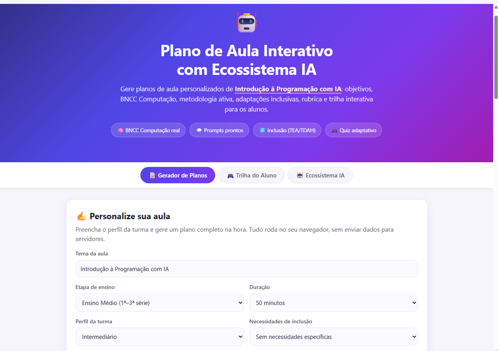
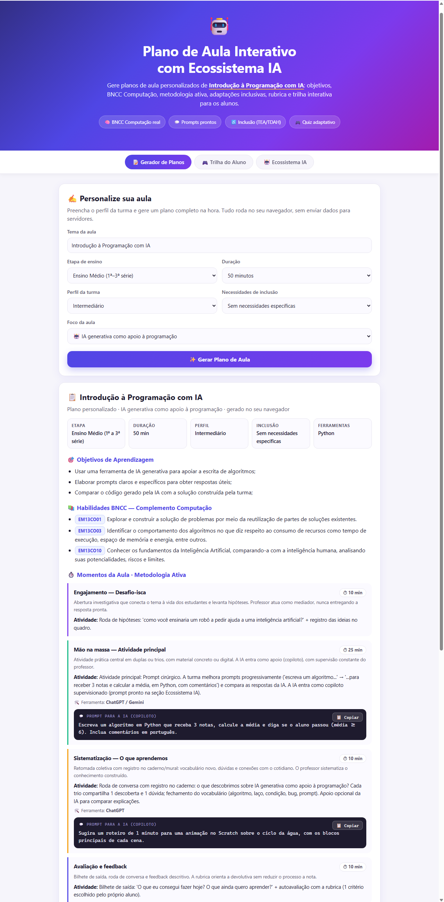

<div align="center">

# 🤖 Plano de Aula Interativo e Personalizado com Ecossistema IA

**Desafio de Projeto — Formação AI for Teachers · DIO & Santander**


[](https://everferreira.github.io/plano-aula-interativo-ia/)

</div>

---

## 📌 Sobre o Projeto

Este repositório documenta o **Desafio de Projeto da Formação AI for Teachers** (DIO + Santander): criar um **Plano de Aula Interativo e Personalizado com Ecossistema IA**. Foi construído como um **produto online real e testável** — não apenas documentação.

O produto é um **Gerador de Planos de Aula de Introdução à Programação com IA** que roda 100% no navegador: o professor preenche o perfil da turma e recebe, na hora, um plano completo e personalizado — com objetivos de aprendizagem, habilidades **reais** da BNCC Computação, metodologia ativa com tempos calculados, atividades mapeadas para ferramentas de IA com **prompts prontos**, adaptações inclusivas e rubrica avaliativa — além de uma **trilha interativa (quiz adaptativo)** para os alunos.

> 💡 **Por que o tema "Introdução à Programação com IA"?** Porque dialoga diretamente com a atuação docente da autora como instrutora sênior de programação na Ctrl+Play e com os eixos de Pensamento Computacional e Cultura Digital do Complemento Computação da BNCC.

---

## 🎯 Objetivos de Aprendizagem do Desafio

- ✅ Aplicar os conceitos de IA na educação em um ambiente prático (produto real)
- ✅ Documentar processos técnicos de forma clara e estruturada (este README + materiais)
- ✅ Utilizar o GitHub para compartilhamento de documentação técnica (repositório público + GitHub Pages)

---

## ✨ Funcionalidades

| # | Funcionalidade | Descrição |
|---|---|---|
| 1 | **Gerador de Plano de Aula** | Formulário com tema, etapa de ensino, duração, perfil da turma, inclusão e foco → gera plano completo instantaneamente |
| 2 | **BNCC Computação real** | Habilidades oficiais do Complemento Computação (códigos EF/EM CO) selecionadas pela etapa de ensino |
| 3 | **Ecossistema IA** | Cada momento da aula mapeado para ferramenta (ChatGPT, Copilot, Gemini, Canva IA, Scratch, Code.org, DIO) com **prompts prontos copiáveis** |
| 4 | **Personalização real** | Objetivos, atividades e prompts variam conforme nível (Iniciante/Intermediário/Avançado) e foco |
| 5 | **Adaptações inclusivas** | Roteiros específicos para TEA, TDAH e TEA+TDAH |
| 6 | **Rubrica avaliativa** | 4 critérios × 4 conceitos, com legenda e autoavaliação |
| 7 | **Trilha Interativa do Aluno** | Quiz adaptativo de lógica/programação: acertos sobem o nível, erros dão dica; perfil final (Explorador → Arquiteto) |
| 8 | **Exportação** | Baixar o plano em **Markdown (.md)** ou Imprimir/PDF |

**Tudo client-side**: zero backend, zero chave de API, funciona offline. Dados não saem do navegador do professor.

---

## 🚀 Como Usar

### Online (recomendado)
1. Acesse o **[▶️ Teste Online](https://everferreira.github.io/plano-aula-interativo-ia/)**;
2. Na aba **📝 Gerador de Planos**, preencha o perfil da turma;
3. Clique em **✨ Gerar Plano de Aula** e explore o resultado;
4. Use a aba **🎮 Trilha do Aluno** para o quiz adaptativo e **🤖 Ecossistema IA** para os prompts prontos;
5. Baixe o plano em `.md` ou imprima em PDF.

### Local
```bash
git clone https://github.com/everferreira/plano-aula-interativo-ia.git
cd plano-aula-interativo-ia/docs
# abra o index.html no navegador (ou: python3 -m http.server)
```

---

## 📁 Estrutura do Repositório

```text
plano-aula-interativo-ia/
├── README.md                          # Documentação do desafio (este arquivo)
├── docs/                              # Produto web — GitHub Pages
│   ├── index.html                     # Página principal (gerador + trilha + ecossistema)
│   ├── app.js                         # Interface: abas, quiz adaptativo, downloads
│   ├── engine.js                      # Motor de geração (funções puras, testáveis)
│   ├── data.js                        # Banco pedagógico: BNCC real, atividades, rubrica
│   └── styles.css                     # Visual (0 dependências externas)
├── plano-de-aula/                     # Materiais pedagógicos
│   ├── plano-de-aula-programacao-com-ia.md          # Exemplo gerado pelo motor (EM, IA)
│   ├── plano-de-aula-logica-fundamental-adaptado.md # Exemplo (Fund. I, TEA)
│   ├── guia-ecossistema-ia.md         # Guia das ferramentas + prompts + princípios éticos
│   └── rubrica-avaliacao.md           # Rubrica detalhada
├── scripts/
│   ├── gerar_planos_exemplo.js        # Gera os planos .md com o MESMO motor do site
│   └── gerar_banner.py                # Gera o banner do README (Pillow)
├── test/
│   └── engine.test.js                 # 189 verificações automáticas do motor (Node)
└── images/                            # Capturas reais do produto + banner
```

---

## 🛠️ Como Foi Feito

### Arquitetura do motor
O coração do produto é um **motor de geração com funções puras** (`engine.js`), alimentado por um banco de dados pedagógico (`data.js`):

```text
entrada do professor → validação → seleção BNCC + objetivos + atividades + ecossistema
                     → distribuição de tempo por momento → plano completo → Markdown
```

- **Dados reais, nada fictício:** as habilidades BNCC foram extraídas do texto oficial do *Complemento Computação* (Resolução CNE/CP nº 1/2022) e validadas em fontes públicas (bncc.dev e dados abertos da SEMED-Manaus) — códigos `EF01CO02` a `EM13CO10` com texto literal;
- **Mesmo motor em todos os lugares:** os planos de exemplo na pasta `plano-de-aula/` foram **gerados pelo próprio motor** (`scripts/gerar_planos_exemplo.js`), provando que o site e a documentação falam a mesma língua;
- **Sem dependências:** HTML/CSS/JS puro, self-hosted, sem CDN — funciona até offline.

### Verificação real (evidências)
| Verificação | Resultado |
|---|---|
| `node test/engine.test.js` — testes do motor (BNCC, personalização, tempos, markdown, quiz) | ✅ **189 verificações passaram** |
| Suíte E2E no Chrome headless (cliques reais: gerar plano, jogo do quiz completo, ecossistema, zero erros de console) | ✅ **E2E-OK** |
| Screenshots reais do produto em execução | ✅ `images/` |
| GitHub Pages (HTTP 200 + assets) | ✅ verificado pós-deploy |

---

## 🖼️ Capturas Reais do Produto

<div align="center">





</div>

---

## 🧩 Ecossistema IA Aplicado

| Ferramenta | Papel no plano de aula |
|---|---|
| **ChatGPT** | Explicações personalizadas, roteiros, prompts de escrita de algoritmos |
| **Microsoft Copilot** | Copiloto de código supervisionado durante a programação |
| **Google Gemini** | Pesquisa assistida e comparação de explicações |
| **Canva IA** | Cartazes e materiais visuais lúdicos |
| **Scratch / Code.org** | Programação em blocos e trilhas de pensamento computacional |
| **DIO — Formação AI for Teachers** | Formação docente e contexto deste projeto |

📄 Detalhes e prompts prontos: [`plano-de-aula/guia-ecossistema-ia.md`](plano-de-aula/guia-ecossistema-ia.md)

---

## 🛡️ Uso Responsável da IA (documentado no produto)

- Declaração de uso da IA a alunos e responsáveis;
- Revisão humana obrigatória de todo conteúdo gerado;
- Privacidade (LGPD): nenhum dado pessoal de aluno em ferramentas de IA;
- IA como apoio à mediação docente, nunca substituição;
- Alfabetização crítica: alucinações, vieses e verificação em fontes confiáveis.

---

## 📚 Recursos Úteis (do enunciado)

- [GitHub Quick Start (DIO)](https://github.com/digitalinnovationone/github-quickstart)
- [GitBook: Formação GitHub Certification](https://aline-antunes.gitbook.io/formacao-fundamentos-github)
- [Documentação do GitHub](https://docs.github.com/pt)
- [Sintaxe básica de escrita Markdown](https://docs.github.com/pt/get-started/writing-on-github/getting-started-with-writing-and-formatting-on-github/basic-writing-and-formatting-syntax)

---

## 👩‍🏫 Autora

<div align="center">


**Ever Maria Tobias Ferreira**

Instrutora Sênior de Programação · Ctrl+Play (desde 2021)
IA Generativa · Python · AWS · Azure · Linux

[](https://linkedin.com/in/evermaria)
[](https://github.com/everferreira)

</div>

---

## 📄 Licença

Distribuído sob a licença **MIT**. Veja o arquivo `LICENSE` para detalhes.

---

<div align="center">

**⌨️ com 💜 por Ever Ferreira**

</div>